<!-- The cards below are generated by scripts/render_cards.py and refreshed daily by .github/workflows/cards.yml -->

<a href="https://portfolio-laxminarayansahu.netlify.app"></a>

<a href="https://portfolio-laxminarayansahu.netlify.app/resume.pdf"></a>
<a href="https://github.com/LAXMINARAYAN24/OmaniacRAG"></a>
<a href="https://github.com/LAXMINARAYAN24/RAG-Showdown"></a>
<a href="https://github.com/LAXMINARAYAN24/VoiceViz"></a>
<a href="https://github.com/LAXMINARAYAN24/IBM-SkillsBuild-Migration-Risk-Analytics"></a>
<a href="https://github.com/LAXMINARAYAN24/Steg-Drop"></a>
<a href="https://github.com/LAXMINARAYAN24/MedicalImageDenoisingPipeline"></a>

